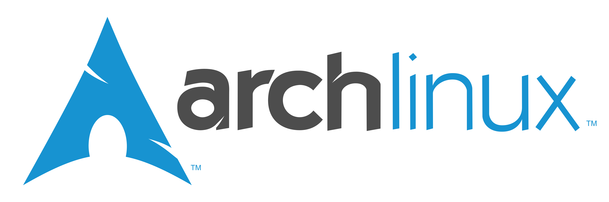

# ArchZFS



Experimental Arch Linux ZFS installation ISO/script.

> [!WARNING]  
> The script is created for personal use and published only as reference; I assume no responsibility for any damage or data loss.

## Credits

The GitHub workflow used to generate the ISO image builds upon the work by r-maerz:
- https://github.com/r-maerz/archlinux-lts-zfs

## Project Layout

- `src/scripts`: installer and helper scripts
- `src/pacman-hooks`: pacman hook scripts and `.hook` units
- `src/zrepl`: zrepl configuration and bootstrap tooling
- `assets`: README/media assets

> [!NOTE]
> Legacy scripts in `src/scripts/backup` are kept as historical reference only and are no longer maintained. The official Arch Linux ISO `archinstall` tool now covers most of their original use cases.

## Requirements

- x86_64 system with UEFI firmware
- target disk you can fully erase for installation
- internet access during install (the installer downloads packages)
- an NVIDIA GPU of the Turing generation (RTX 20xx / GTX 16xx) or newer if you want the preinstalled NVIDIA driver; Pascal and older GPUs need the proprietary legacy branch (`nvidia-580xx-dkms` from the AUR) and are not covered by the default package set
- Arch Linux familiarity for manual recovery/debugging

## Quick Start ⚡

1. Download latest ISO + checksum from Releases:
```bash
# Replace with the actual Release asset URLs
curl -L -o archlinux-lts-zfs-x86_64.iso <ISO_URL>
curl -L -o archlinux-lts-zfs-x86_64.iso.sha256 <SHA_URL>
```

2. Verify:
```bash
sha256sum -c archlinux-lts-zfs-*-x86_64.iso.sha256
```

3. Write USB (replace `/dev/sdX`):
```bash
sudo dd if=archlinux-lts-zfs-*-x86_64.iso of=/dev/sdX bs=4M status=progress conv=fsync
sync
```

4. Boot USB and run installer:
```bash
chmod +x /root/archzfs.sh
/root/archzfs.sh
```

The installer validates the environment (root, UEFI, network, available disks), asks for the target disk and requires typing the device path before erasing it. Candidate disks exclude `zram`/loop devices and — when it can be detected — the disk hosting the running live medium, so the installation medium itself is not offered as a target.

## Script Implementation Details 🧩

The following details reflect how `src/scripts/archzfs.sh` configures the system.

#### ZFS Structure + Encryption ####
- Disk layout: GPT with a 1 GiB EFI System Partition (ESP) and the rest for ZFS.
- Pool: `zroot` on the second partition with `ashift=12`, `compression=lz4`, `atime=off`, `xattr=sa`, `autotrim=on`, `canmount=off`, `mountpoint=none`.
- Pool compatibility: `openzfs-2.3`. The pool is created with an explicit OpenZFS feature set so that the bundled ZFSBootMenu image can always import it (see below).
- Datasets: `zroot/ROOT` (mountpoint `none`), `zroot/ROOT/default` (mountpoint `/`, `canmount=noauto`) and `zroot/home` (mountpoint `/home`).
- Dataset separation: `/home` lives in its own dataset so snapshots and rollbacks of the root filesystem (`zroot/ROOT/default`) never touch user data. It is mounted by `zfs-mount.service` at boot (`zfs-mount` is enabled) and is mounted under the altroot at `/mnt/home` during installation.
- Encryption: `aes-256-gcm` with a passphrase. A temporary key file in `/tmp` is used only for the non-interactive `zpool create` call and is removed immediately. The persistent `keylocation` is set to `prompt`.
  - The UKI is stored on the unencrypted ESP, so it must not contain the ZFS passphrase. The installer never writes a persistent key file, and it refuses to install an initramfs or UKI that contains `/etc/zfs/zroot.key`.
  - The normal UKI boot asks for the ZFS passphrase once, in the initramfs.
  - The ZFSBootMenu fallback asks for the passphrase once in ZFSBootMenu and then again in the target initramfs: a kexec boundary cannot pass the loaded ZFS key. This is expected.
  - Do not copy a key file to the ESP or embed it in the UKI; that would defeat the pool encryption.

#### Boot Chain: systemd-boot + UKI, with ZFSBootMenu fallback ####
- The default firmware entry is a signed `systemd-boot`.
- `/efi/EFI/Linux/arch-linux-lts.efi` is a Unified Kernel Image containing the kernel, the dracut initramfs and the kernel command line (`root=zfs:zroot/ROOT/default`). systemd-boot auto-discovers it from `/efi/EFI/Linux/`; the default entry is set in `/efi/loader/loader.conf`.
- `/etc/kernel/cmdline` contains the command line embedded in the UKI; it is also used by the update hook.
- ZFSBootMenu remains installed as a second firmware entry and as an entry in the systemd-boot menu for snapshots/recovery.
- The normal `/boot/initramfs-linux-lts.img` is still generated for the ZFSBootMenu fallback.
- A ZFS rollback does not roll back the UKI on the ESP. To boot an older snapshot, use the ZFSBootMenu entry (it reads the kernel/initramfs from that snapshot); after a permanent rollback, rebuild the UKI with `dracut`/the pacman hook.

#### ZFSBootMenu ####
- The latest release is downloaded from the ZFSBootMenu GitHub release page and verified with `signify` against `sha256.sig` and the project public key.
- The `linux6.12` release variant is selected explicitly (ZFSBootMenu runs its own kernel; `ZBM_KERNEL_VARIANT` can override it). If that asset is missing, the script falls back to the first release EFI.
- The EFI binary is installed to `/efi/EFI/zbm/zfsbootmenu.EFI`. Its embedded `.cmdline` section is patched with `spl_hostid`, `zbm.prefer=zroot`, `zbm.import_policy=hostid` and `zbm.timeout=3`, so it works when chainloaded by systemd-boot under Secure Boot.
- ZFSBootMenu is registered with `efibootmgr` as a fallback and added to `/efi/loader/entries/zfsbootmenu.conf`.
- Updating ZFSBootMenu later requires re-signing the new EFI with `sbctl sign -s` (there is no pacman hook for a manually downloaded file).

#### ZRAM ####
- Service: `zram-generator` creates `zram0`.
- Size: `min(ram, 32768)`.
- Compression: `zstd`.
- VM tuning for zram-backed swap: `vm.swappiness=180`, `vm.watermark_boost_factor=0`, `vm.watermark_scale_factor=125`, `vm.page-cluster=0`.

#### Secure Boot ####
- Keys: `sbctl` creates PK/KEK/db keys if missing (stored in `/var/lib/sbctl`).
- Enrollment: only if the firmware reports `Setup Mode: Enabled`; `enroll-keys -m` includes the Microsoft certificates.
- Signing: systemd-boot (`/efi/EFI/systemd/systemd-bootx64.efi` and `/efi/EFI/BOOT/BOOTX64.EFI`), the UKI (`/efi/EFI/Linux/arch-linux-lts.efi`) and the ZFSBootMenu EFI are signed and recorded in the sbctl database.
- The pacman hook re-signs the UKI after kernel/ZFS/dracut updates and the systemd-boot copies after systemd updates.
- `systemd-boot-update.service` is disabled: its automatic `bootctl update` is not signed. The pacman hook performs the equivalent update and signs the result.
- If the firmware is not in Setup Mode, keys are not enrolled automatically. Either enroll them manually (`sbctl enroll-keys -m`) or disable Secure Boot before first boot; otherwise firmware may reject the custom-signed boot chain.
- Scope: Secure Boot verifies systemd-boot, the UKI and the ZFSBootMenu EFI. Arch's default kernel does not enable lockdown when Secure Boot is active, so the kernel/initramfs that ZFSBootMenu kexecs and locally built DKMS modules (ZFS, NVIDIA) are not separately signature-verified. If you enable kernel lockdown, sign those components too.

#### Dracut and UKI ####
- Config: `/etc/dracut.conf.d/99-zfs.conf`.
- Modules: adds the `zfs` module; the initramfs and the UKI do **not** contain a ZFS key file.
- Traditional initramfs: host-only for `linux-lts`, compressed with `zstd`; the script verifies that it exists and contains `zfs.ko`.
- UKI: built by dracut with `--uefi` and the command line from `/etc/kernel/cmdline`, then verified to contain `.linux`, `.initrd` and `.cmdline` sections and the expected command line.
- The update hook rebuilds the initramfs and UKI and re-signs the UKI with `sbctl`. It runs unconditionally on every matching transaction (kernel, ZFS, dracut or systemd upgrade): there is no opt-out sentinel, because the boot chain must stay in sync with the installed packages.

#### Desktop Environment ####
- A ZFS snapshot named `zroot/ROOT/default@base` is always created before desktop-related steps.
- After the snapshot, the installer asks whether to install the KDE Plasma desktop stack (`[Y/n]` prompt, default `Y`).
- If you choose `n`, installation stops with a base system: audio, NVIDIA, yay and desktop packages are **not** installed.
- KDE Plasma 6 (Wayland session), Plasma Login Manager (`plasma-login-manager`, Wayland-only KWin greeter) as display manager, KDE applications (`konsole`, `dolphin`, `kate`), KDE portals, NetworkManager applet (`plasma-nm`), audio applet (`plasma-pa`), screen and power management.
- No Bluetooth stack: `bluedevil`, `bluez` and `bluez-utils` are not installed and `bluetooth.service` is not enabled.
- No Xorg server: `xorg-server` is not installed. `plasma-workspace` still hard-depends on `xorg-xwayland` (XWayland for X11-only applications) and on the small `xorg-xmessage`/`xorg-xrdb` utilities; these are not an X11 session or an X11 display manager.
- Display manager: `plasmalogin.service` is enabled with `systemctl enable plasmalogin.service`; the unit provides the `display-manager.service` alias. The installer does not write `/etc/plasmalogin.conf`, so the built-in defaults are used. For customisation, create `/etc/plasmalogin.conf` to override them (see the upstream Plasma Login documentation).

#### Audio ####
- Installed only when desktop installation is selected.
- Audio stack: PipeWire with WirePlumber session manager.
- Packages installed: `pipewire`, `wireplumber`, `pipewire-pulse`, `pipewire-alsa`, `alsa-utils`, `pavucontrol-qt`.

#### NVIDIA Drivers ####
- Installed only when desktop installation is selected.
- Driver path in script: NVIDIA Open kernel module variant for the LTS kernel.
- Packages installed: `nvidia-open-lts`, `nvidia-settings`, `nvidia-utils`, `opencl-nvidia`, `libxnvctrl`, `egl-wayland`.
- `nvidia-open-lts` supports Turing (RTX 20xx / GTX 16xx) and newer GPUs. Pascal and older GPUs need the proprietary legacy branch (`nvidia-580xx-dkms` from the AUR) and are not covered by the default package set.

#### AUR Helper ####
- `yay` is installed (as the target user) only when desktop installation is selected.

## Hooks and Zrepl ♻️

### Pacman Hooks (`src/pacman-hooks`)

Provides pacman hooks for:
- creating pre-transaction ZFS snapshots (`pacman-*`)
- rebuilding the dracut initramfs and the systemd-boot UKI after kernel, ZFS, dracut or systemd updates, then re-signing the boot chain

The installer automatically installs the UKI refresh hook from the ISO
(`/usr/local/share/archzfs`). To install both helpers manually:

```bash
sudo install -Dm755 src/pacman-hooks/zfs-pacman-snapshot.sh /usr/local/bin/zfs-pacman-snapshot
sudo install -Dm755 src/pacman-hooks/zfs-dracut-kernel-refresh.sh /usr/local/bin/zfs-dracut-kernel-refresh
sudo install -Dm644 src/pacman-hooks/50-zfs-snapshot-pre.hook /etc/pacman.d/hooks/50-zfs-snapshot-pre.hook
sudo install -Dm644 src/pacman-hooks/60-zfs-dracut-post.hook /etc/pacman.d/hooks/60-zfs-dracut-post.hook
```

Snapshot retention can be tuned in `/etc/zfs-pacman-snapshot.conf`
(`ZFS_PACMAN_MAX_SNAPSHOTS=3` by default). See `src/pacman-hooks/README.md`.

### Zrepl (`src/zrepl`)

`src/zrepl` contains a local push-to-disk zrepl setup:
- source: auto-detected dataset mounted on `/` (or `--source-dataset` override)
- destination: `backup/zrepl/sink`
- schedule: hourly snapshot + replication
- pruning: retention grid for `zrepl_*` and `pacman-*`, while keeping `base`

Quick start:

```bash
cd src/zrepl
./scripts/bootstrap-zrepl-local-backup.sh --source-pool zroot --source-dataset zroot/ROOT/default
sudo install -m 0644 zrepl.yml /etc/zrepl/zrepl.yml
sudo zrepl configcheck --config /etc/zrepl/zrepl.yml
sudo systemctl restart zrepl
sudo zrepl signal wakeup backup_hourly
```

If the backup pool does not exist yet and must be created on `/dev/sdc`:

```bash
./scripts/bootstrap-zrepl-local-backup.sh --source-pool zroot --source-dataset zroot/ROOT/default --backup-pool backup --create-backup-pool --apply
```

## Contributing 🤝

Contributions are welcome for bug fixes, documentation improvements, and installer reliability updates.

1. Fork the repository and create a focused branch for your change.
2. Keep changes scoped and include clear commit messages.
3. Update documentation if behavior, flags, paths, or defaults change.
4. Open a pull request with:
   - what changed
   - why it changed
   - how you tested it

Before opening a PR, run the same checks as CI:

```bash
while IFS= read -r file; do bash -n "$file"; done < <(git ls-files '*.sh')
shellcheck --severity=warning --external-sources $(git ls-files '*.sh')
```

## Testing

- Static checks run in CI (`.github/workflows/lint.yml`): `bash -n` and `shellcheck` on every tracked `*.sh` file.
- The ISO build workflow performs a post-build sanity check (installer, UKI refresh helper/hook and UEFI boot image present) before computing the checksum.
- A full installation test requires UEFI firmware or a VM with OVMF, and (for the NVIDIA path) real supported hardware. The project does not currently include an automated VM installation test.

## Support

If you find a bug or regression, open a GitHub issue with:

- the script/command you ran
- your hardware/storage layout summary
- relevant logs or terminal output

Installer logs are written to `/var/log/archzfs-install.log` in the live environment.

## License

This project is licensed under the terms in `LICENSE`.
